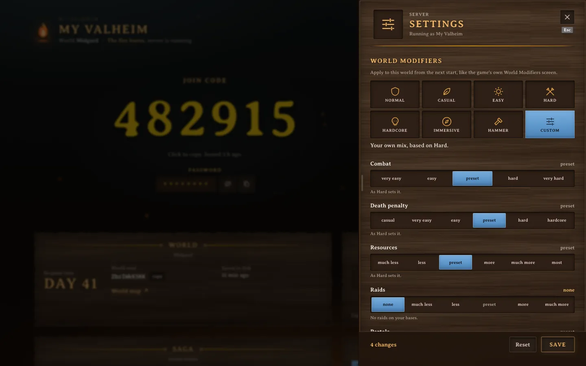

<div align="center">


# Skald

**A campfire dashboard for Valheim dedicated servers.**

[](LICENSE)
[](https://github.com/krystianslowik/skald/actions/workflows/ci.yaml)
[](https://github.com/krystianslowik/skald/releases)


</div>

Running a Valheim server for friends means someone asks "what's the code again?"
every evening, and nobody knows if last night's backup happened. Skald sits next
to the server and puts it all on one password-protected page:

- the 6-digit crossplay join code, one click to copy
- who is online, who played when, and how often they died
- the world: in-game day, seed, a link to the map, last save
- backups you can download, plus backup / update / restart buttons (press and hold, so nobody restarts by accident)
- player profiles with streaks and badges
- server settings: name, password, public listing and world modifiers, applied now or once everyone has left
- the live server log
- Prometheus metrics, alert rules and a Grafana dashboard

It works with the [community Valheim server image](https://github.com/community-valheim-tools/valheim-server-docker)
with crossplay on, so Xbox, PlayStation, Switch and PC players join without port
forwarding. The UI is in English and Polish. It installs as a PWA, and there's an
optional campfire crackle if you want it.

<table>
  <tr>
    <td width="50%"></td>
    <td width="50%"></td>
  </tr>
</table>

## Server settings



The settings sheet changes the server name, password, public listing, world
modifiers and save interval, and the dashboard shows the password next to the
join code. The game picks the settings up through a small pre-run hook when it
restarts, so a save never restarts anything by itself. Setup and the
Kubernetes details are in [docs/configuration.md](docs/configuration.md#server-settings).

## How it works


The agent runs in the game's network namespace (a native sidecar in Kubernetes,
`network_mode: service:valheim` in Compose). The image's syslogd forwards every
log line to it, and supervisord's XML-RPC lets it trigger backups, update checks
and restarts. It reads `/config` read-only for world info and backup zips, and
writes server settings only to its own settings directory. No Docker socket, no
exec.

The web tier is a separate container, and in Kubernetes a separate pod. Anything
that touches the game pod restarts the game and kicks everyone, so you can
redeploy the dashboard as often as you like and nobody in game notices. It keeps
event history in SQLite and pushes updates to browsers over a WebSocket.

## Quick start (Docker Compose)

The game image is amd64 only.

```sh
git clone https://github.com/krystianslowik/skald.git
cd skald/deploy/compose
cp .env.example .env
```

Fill in `.env`:

```sh
openssl rand -hex 32   # AGENT_TOKEN
openssl rand -hex 24   # SUPERVISOR_HTTP_PASS
openssl rand -hex 32   # SESSION_SECRET

# dashboard password as an argon2id hash (keep the single quotes in .env)
printf '%s' 'your password' | docker run --rm -i ghcr.io/krystianslowik/skald-web hash-password
```

```sh
docker compose up -d
docker compose logs -f valheim   # first boot downloads ~2.4 GB
```

Open <http://localhost:8080>. Players join with Join Game, Add server, the
6-digit code and the server password.

> [!IMPORTANT]
> Compose sets `COOKIE_SECURE=false` so login works on plain `http://localhost`.
> If Skald is reachable from anywhere else, put it behind HTTPS and set it to `true`.

Already running the community image? Add the `SYSLOG_*` and `SUPERVISOR_*`
variables from [`docker-compose.yaml`](deploy/compose/docker-compose.yaml) to
your `valheim` service and add the `agent` and `skald-web` services.

## Kubernetes

There's a kustomize example in [`deploy/kubernetes`](deploy/kubernetes). It needs
Kubernetes 1.29+ for native sidecars.

```sh
cd deploy/kubernetes
cp secrets.example.yaml secrets.yaml   # fill in, gitignored
kubectl apply -k .
kubectl -n valheim port-forward svc/skald-web 8080:8080
```

How you expose `skald-web` (Ingress, Gateway, a tunnel) is up to you. Set
`TRUSTED_IP_HEADER` to whatever header your proxy uses so the login rate limit
sees real client IPs.

All environment variables are listed in [docs/configuration.md](docs/configuration.md).
Metrics, alert rules and the Grafana dashboard are in [docs/metrics.md](docs/metrics.md).

## Security

- One panel password, stored only as an argon2id hash. Login is limited to 5
  tries a minute, then a 15-minute lockout.
- Sessions are signed `HttpOnly`, `SameSite=Strict` cookies.
- The two tiers share a token. Backup downloads are name-checked and refuse symlinks.
- With crossplay the server only dials out to PlayFab, so there are no game
  ports to forward or scan.
- The agent and the web container run as non-root on read-only root filesystems.
- The metrics port (`:9464`) has no token. Keep it on your monitoring network.
- Server settings accept only allow-listed launch options from structured
  input, and the game parses the settings file instead of running it. The
  settings volume holds the server password in plain text, for the agent and
  the game only.

Report issues as described in [SECURITY.md](SECURITY.md).

## Crossplay notes

- The server joins PlayFab and players come in through Microsoft's relays. It
  needs outbound HTTPS and outbound UDP 1024-65535, and nothing inbound.
- The join code can change when the server restarts, so the dashboard always
  shows the current one.
- Clients need the same game version as the server. Console patches can lag PC by days.
- Xbox players need "You can join cross-network play" allowed in their privacy settings.

## Development

Needs Go 1.26+, Bun 1.3+ and Node 22+. A built-in mock server fakes a month of
history, players coming and going, deaths and raids (password: `ognisko`).

```sh
cd web && npm install && npm run build
cd ../server && bun install && bun run dev    # http://localhost:8080
```

Tests:

```sh
cd agent  && go vet ./... && go test -race ./...
cd server && bun run typecheck && bun test
cd web    && npm run typecheck && npm test
```

To add a language, copy `web/src/i18n/en.ts`, register it in
`web/src/i18n/index.tsx` and in `LOCALES` in `server/src/config.ts`.

## Known gaps

- Joins, leaves, deaths, platforms, saves and the network summary are
  confirmed against a Valheim 1.0.17 crossplay session, as are boss progress
  and world modifiers read from a 1.0.17 save. Raid detection still uses a
  pre-1.0 pattern; if you have a real 1.0 raid line, please open an issue.
- Xbox and Steam are the only platforms seen so far. PlayStation and Switch
  players may show without a platform mark until their ID prefix is known.
- A player's platform is matched to their character by arrival order, so two
  people connecting within the same few seconds could swap marks.
- Boss slots follow the seven vanilla bosses up to Fader; a Deep North boss
  key isn't known yet.
- One game server and one panel password per Skald instance.

## Contributing

Issues and pull requests are welcome, see [CONTRIBUTING.md](CONTRIBUTING.md).

## License

[Apache License 2.0](LICENSE). Copyright 2026 Krystian Slowik.

<sub>Skald is a fan project, not affiliated with Iron Gate Studio or Coffee Stain.
Valheim is a trademark of its owners.</sub>
