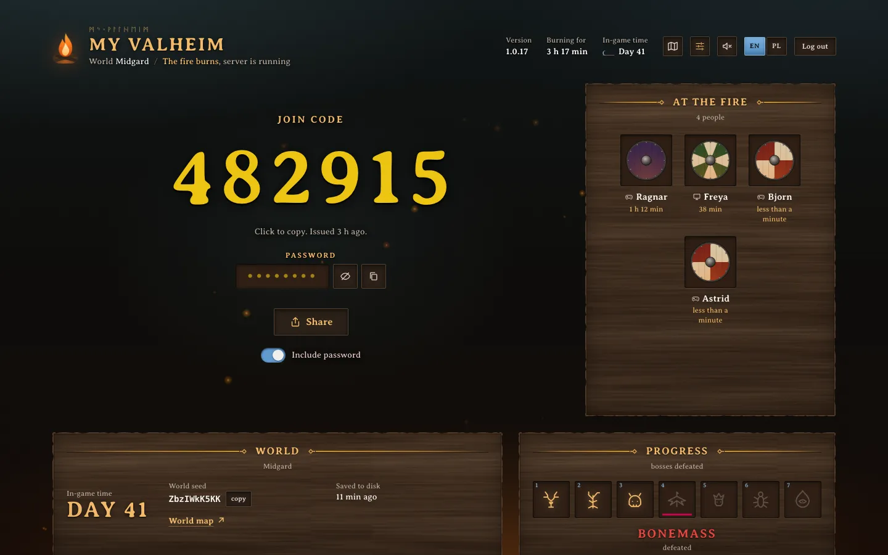
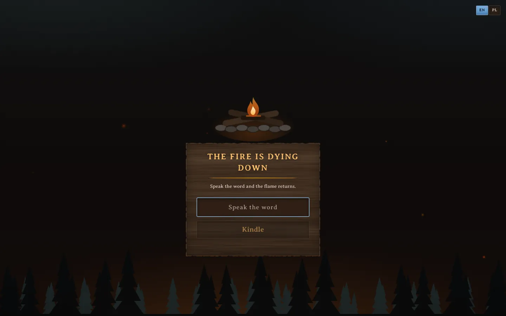
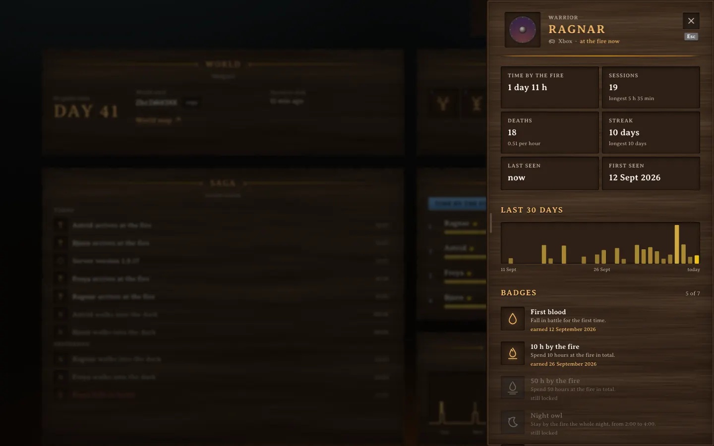
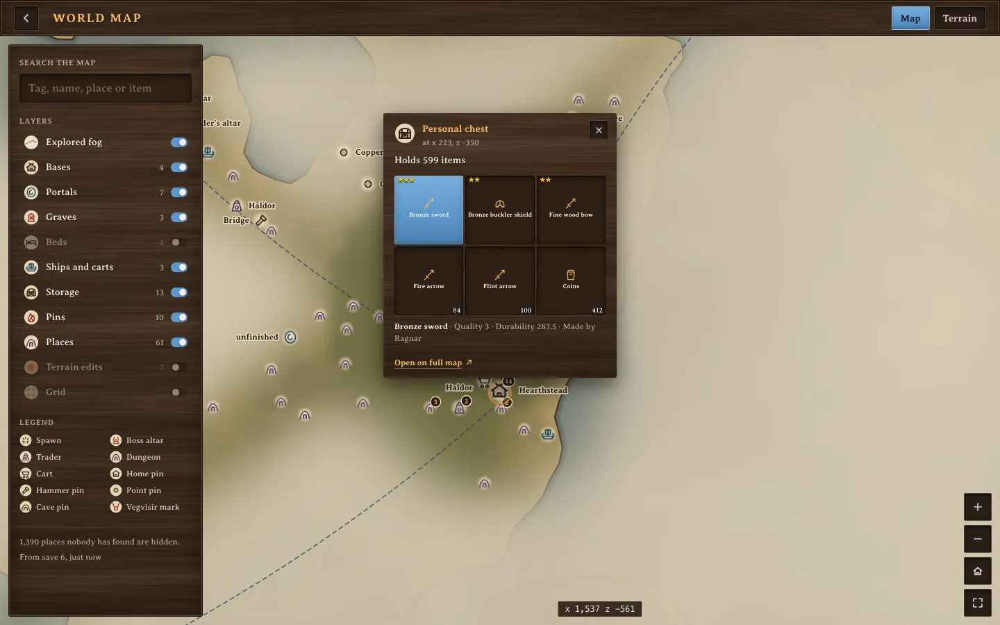
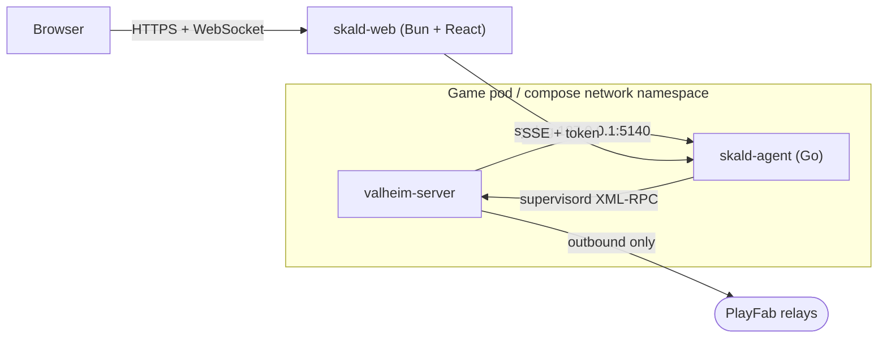

<div align="center">


# Skald

**A campfire dashboard for Valheim dedicated servers.**

[](LICENSE)
[](https://github.com/krystianslowik/skald/actions/workflows/ci.yaml)
[](https://github.com/krystianslowik/skald/releases)



</div>

Every evening someone asks "what's the code again?", and nobody knows if last
night's backup happened. Skald sits next to your Valheim server and answers both
on one password-protected page your friends can open on their phones:

- the crossplay join code, one tap to copy or share
- who's online, who played when, how often they died, streaks and badges
- a world map drawn from the save: bases, portals, graves, ships, pins and the bosses you've found
- what's in every chest, cart and ship you built, searchable ("where's our iron?")
- backups, restarts and server settings, behind press-and-hold buttons
- the live server log, plus Prometheus metrics and a Grafana dashboard

It works with the [community Valheim server image](https://github.com/community-valheim-tools/valheim-server-docker)
with crossplay on, so Xbox, PlayStation, Switch and PC players get in without
port forwarding. English and Polish. It installs as an app on your phone.

<table>
  <tr>
    <td width="50%"></td>
    <td width="50%"></td>
  </tr>
</table>

## The map



Skald reads the world save and draws what's in it on parchment: the land, the
part your cartography tables have explored, and everything people built or left
behind. Tap a chest and it opens as a slot grid like the game's. Tap a portal and
it shows where it leads. Places nobody has found stay hidden, and so do dungeon
and shipwreck chests.

Two extras are opt-in, because they use your own copy of the game:

- **Terrain.** A small job runs the game's own world generator for your seed and
  the agent paints real biomes and mountains under the fog.
- **Item icons.** A sidecar builds an icon sheet from your installed server files
  so chests show real items instead of category marks.

> [!NOTE]
> Skald ships no Valheim art or game code. Icons and terrain are made on your
> server from files you installed, and they stay there, behind the panel password.

Setup for both is in [docs/configuration.md](docs/configuration.md).

## Admin bridge (opt-in)

Run game night from your phone. Put a message on every screen, drop items or a
saved kit next to a player, teleport someone to a boss altar, skip to morning, start or stop
a raid, spawn a troll for fun, repair the base. Players move on the map in real
time, and every action lands in the Saga ("Sigrun spawned 20 Wood for Ragnar").

This one needs a small server-side BepInEx plugin, the [Skald bridge](bridge/README.md).
Players install nothing. Before you turn it on, know three things:

- Your server runs modded. Crossplay was tested with an Xbox player on game build
  `l-1.0.17` and everything listed above worked.
- A game patch can break it. The plugin turns itself off instead of crashing, and
  on an untested build the panel waits for an admin to say it's fine.
- Without `ADMIN_PASSWORD_HASH`, everyone with the panel password is an admin.

Kill switches, the full command list and what's still untested are in
[docs/configuration.md](docs/configuration.md#admin-bridge).

## How it works



A small Go agent shares the game's network namespace. The game's syslog feeds it
every log line, supervisord lets it run backups and restarts, and it reads the
save files read-only. No Docker socket, no exec.

The web app lives in its own container, or its own pod in Kubernetes. Touching
the game pod restarts the game and kicks everyone, so the dashboard is kept out
of it and you can redeploy it whenever you want.

## Quick start (Docker Compose)

The game image is amd64 only.

```sh
git clone https://github.com/krystianslowik/skald.git
cd skald/deploy/compose
cp .env.example .env
```

Fill in `.env`:

```sh
openssl rand -hex 32   # AGENT_TOKEN
openssl rand -hex 24   # SUPERVISOR_HTTP_PASS
openssl rand -hex 32   # SESSION_SECRET

# dashboard password as an argon2id hash (keep the single quotes in .env)
printf '%s' 'your password' | docker run --rm -i ghcr.io/krystianslowik/skald-web hash-password
```

```sh
docker compose up -d
docker compose logs -f valheim   # first boot downloads ~2.4 GB
```

Open <http://localhost:8080>. Players join with Join Game, Add server, the code
and the server password.

> [!IMPORTANT]
> Compose sets `COOKIE_SECURE=false` so you can log in on plain `http://localhost`.
> Anywhere else, put Skald behind HTTPS and set it to `true`.

Already running the community image? Copy the `SYSLOG_*` and `SUPERVISOR_*`
variables from [`docker-compose.yaml`](deploy/compose/docker-compose.yaml) into
your `valheim` service and add the `agent` and `skald-web` services.

## Kubernetes

There's a kustomize example in [`deploy/kubernetes`](deploy/kubernetes). It needs
Kubernetes 1.29+ for native sidecars.

```sh
cd deploy/kubernetes
cp secrets.example.yaml secrets.yaml   # fill in, gitignored
kubectl apply -k .
kubectl -n valheim port-forward svc/skald-web 8080:8080
```

Expose `skald-web` however you like and set `TRUSTED_IP_HEADER` to your proxy's
client IP header, so the login rate limit sees real addresses. Every setting is
in [docs/configuration.md](docs/configuration.md), metrics and alerts in
[docs/metrics.md](docs/metrics.md).

## Security

The panel password is stored only as an argon2id hash, and login locks for 15
minutes after 5 bad tries. With crossplay the server only dials out, so there are
no game ports to forward or scan. The containers run as non-root on read-only
filesystems, and player platform IDs never leave the agent. Two things to keep
private: the metrics port has no token, and the settings volume holds the server
password in plain text. More in [SECURITY.md](SECURITY.md).

## Crossplay notes

- Players come in through Microsoft's PlayFab relays. The server needs outbound
  HTTPS and UDP 1024-65535, nothing inbound.
- The join code can change on restart. The dashboard always shows the current one.
- Everyone needs the same game version. Console patches can lag PC by days.
- Xbox players have to allow "You can join cross-network play" in their privacy settings.

## Development

You need Go 1.26+, Bun 1.3+ and Node 22+. A built-in mock fakes a month of
history and players walking around the map (password `ognisko`).

```sh
cd web && npm install && npm run build
cd ../server && bun install && bun run dev    # http://localhost:8080
```

Tests:

```sh
cd agent  && go vet ./... && go test -race ./...
cd bridge && dotnet test tests && sh build.sh
cd server && bun run typecheck && bun test
cd web    && npm run typecheck && npm test
```

To add a language, copy `web/src/i18n/en.ts` and register it in
`web/src/i18n/index.tsx` and in `LOCALES` in `server/src/config.ts`.

## Known gaps

- Only Xbox and Steam players have been seen so far, so PlayStation and Switch
  players may show up without a platform mark.
- Two players joining within the same few seconds can swap platform marks.
- The Deep North boss isn't on the boss path yet.
- One game server per Skald instance.
- Some bridge commands still need a test with a real player: kicking or banning
  someone who's online, teleporting to coordinates or to another player, crop
  growth, and map reveal and pins.

## Contributing

Issues and pull requests are welcome, see [CONTRIBUTING.md](CONTRIBUTING.md).

## License

[Apache License 2.0](LICENSE). Copyright 2026 Krystian Slowik.

<sub>Skald is a fan project, not affiliated with Iron Gate Studio or Coffee Stain.
Valheim is a trademark of its owners.</sub>
