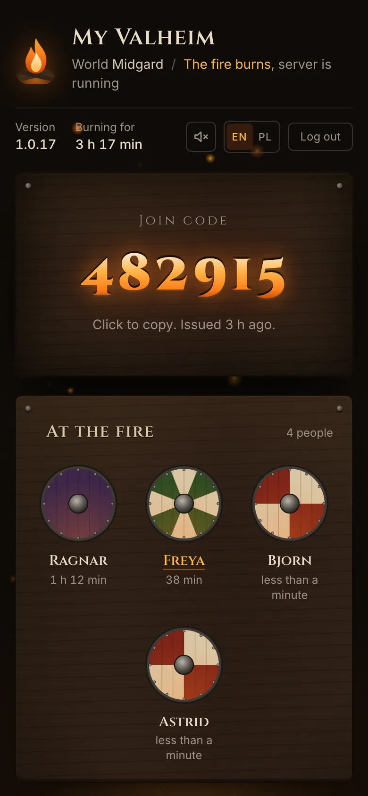
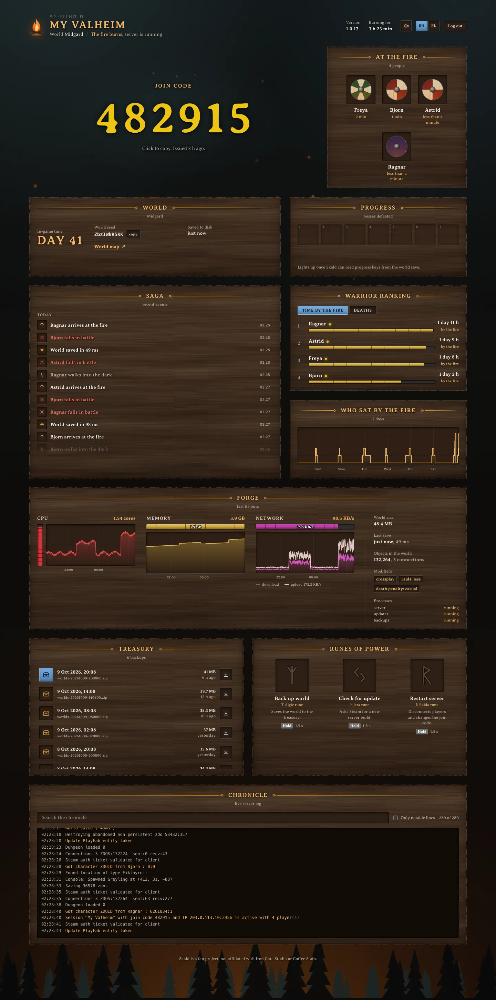
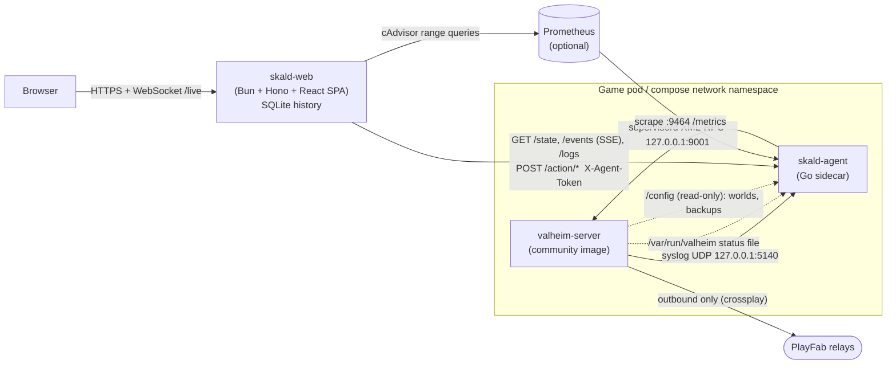

<div align="center">


# Skald

**A campfire dashboard for Valheim dedicated servers.**

The join code, who is at the fire, the saga of the world, its backups and the
server's pulse, on one password-protected page that feels like the game.

[](LICENSE)
[](https://github.com/krystianslowik/skald/actions/workflows/ci.yaml)
[](https://github.com/krystianslowik/skald/releases)
[](agent/go.mod)
[](server/package.json)
[](web/package.json)


</div>

---

## Contents

- [What it is](#what-it-is)
- [Features](#features)
- [How it works](#how-it-works)
- [Quick start (Docker Compose)](#quick-start-docker-compose)
- [Kubernetes](#kubernetes)
- [Configuration](#configuration)
- [Security model](#security-model)
- [Metrics and alerts](#metrics-and-alerts)
- [Crossplay notes](#crossplay-notes)
- [Development](#development)
- [Limitations and known unknowns](#limitations-and-known-unknowns)
- [Roadmap](#roadmap)
- [Contributing](#contributing) / [License](#license)

## What it is

Running a Valheim server for friends usually means someone asking "what's the
code again?" in the group chat, a terminal tab full of logs, and nobody quite
sure whether last night's backup happened. Skald sits next to the server and
turns all of that into one page your whole group can open:

- the **6-digit crossplay join code**, burned into wood, one click to copy;
- **who is playing right now**, and who played when, for how long, and how
  often they died doing it;
- the **world**: in-game day, seed, a link to the map, size, last save;
- **backups** you can download, and **buttons** for backup, update check and
  restart, behind a deliberate press-and-hold;
- the **live server log**, filterable.

It is built for the [community Valheim server image](https://github.com/community-valheim-tools/valheim-server-docker)
(formerly `lloesche/valheim-server`) with **crossplay** on, so Xbox, PlayStation,
Switch and PC players can all join without any port forwarding.

The interface speaks **English** and **Polish**, and is written so that more
languages are a single dictionary file away.

<table>
  <tr>
    <td width="50%"></td>
    <td width="50%"></td>
  </tr>
  <tr>
    <td align="center"><sub>The login: speak the word and the flame returns.</sub></td>
    <td align="center"><sub>A warrior's profile: stats, the last 30 days, badges.</sub></td>
  </tr>
</table>

## Features

**Live server**
- Flame status in the header: burning, embers or ash, from the server's own
  status file; game version and uptime.
- Join code with a per-digit ignition animation whenever it changes; click to
  copy (with a spark burst).
- PlayFab connection state, supervisor process health, an outage banner when
  the dashboard loses its link to the server (last known state stays on screen).

**Players and saga**
- "At the fire": online players as painted Viking shields that step out of the
  dark when they join and leave as smoke.
- The saga: joins, departures, deaths, raids, saves, restarts, version changes
  and join codes, grouped by day.
- Ranking by time at the fire or by deaths; a 7-day "who sat by the fire" chart.

**World**
- In-game day (derived from the world's `netTime`), seed name with copy button,
  a link to [valheim-map.world](https://valheim-map.world) for that seed, time
  of the last save on disk.
- Boss path (Eikthyr to Fader), ready for when global keys can be read.

**Forge (resources)**
- CPU, memory and network charts for the last 6 hours, from Prometheus
  (optional; a friendly empty state explains how to turn them on).
- World size, last save duration, object (ZDO) count and connections, world
  modifiers as chips, supervisor processes.

**Treasury (backups)**
- Every `worlds-*.zip` the image produces, newest first, size and age,
  **downloadable** straight from the page (streamed, never buffered).

**Actions (runes of power)**
- Back up now, check for an update, restart the server.
- Press and hold for 1.5 s (pointer, Space or Enter) so nobody restarts the
  server by accident; one action at a time.

**Profiles and badges**
- Click any name for a profile sheet: total playtime, sessions and the longest
  one, deaths per hour, current and longest day streak, a 30-day bar chart.
- Seven badges: First blood, 10 h and 50 h by the fire, Night owl (02:00 to
  04:00), Unbroken (5 h without dying), Raid veteran, 7-day streak. Days and
  nights follow the time zone you configure.

**PWA and ambience**
- Installable as an app (manifest + app-shell service worker that never caches
  live data or the API).
- Canvas embers, firelight flicker, vignette and grain; an optional procedural
  campfire crackle (Web Audio, no audio files, off by default).
- `prefers-reduced-motion` turns the theatrics off.

**Metrics and alerts**
- The agent exposes Prometheus metrics; a ready PrometheusRule and a Grafana
  dashboard live in [`deploy/monitoring`](deploy/monitoring).

<div align="center">
  
  <br /><sub>One column on phones.</sub>
</div>

<details>
<summary><b>The whole page</b> (tall screenshot)</summary>
<br />

</details>

## How it works



**The agent** is a small Go binary (standard library only) that lives *inside*
the game's network namespace: as a native sidecar in Kubernetes, or with
`network_mode: service:valheim` in Compose. That placement is the whole trick:

- The image's busybox `syslogd` can forward every line to a remote host. Pointed
  at `127.0.0.1:5140`, the agent receives the game's log without touching the
  container runtime, a log shipper or the Docker socket. A single regex table
  turns lines into typed events (join code, player count, PlayFab state, joins,
  deaths, saves, raids, version).
- The image runs everything under supervisord. With `SUPERVISOR_HTTP=true`
  supervisord exposes XML-RPC on `:9001`; the agent uses it to signal the
  backup and updater loops (`HUP`) and to stop and start the server. It never
  needs to exec into anything.
- `/config` is mounted read-only to measure the world, decode the small save
  headers (seed, `netTime`) and list and stream backup zips. The shared
  `/var/run/valheim` holds the image's status file (`starting`, `running`, ...).

The agent keeps a ring buffer of the last 5000 events and serves them as
Server-Sent Events with resume (`?since=<seq>`), plus a JSON snapshot and the
log tail. Every endpoint except `/healthz` requires `X-Agent-Token`.

**The web tier** is a separate process and, in Kubernetes, a **separate pod**.
That is deliberate: any change to the game pod (including the sidecar's image
or env) restarts the game, which kicks everybody and **rotates the join code**.
Keeping the dashboard out of that pod means you can update Skald's UI as often
as you like without anyone noticing in game. The web tier holds one SSE stream
to the agent (reconnect with backoff, resume by sequence number), persists the
notable events to SQLite, derives history, rankings, streaks and badges from
them, and fans everything out to browsers over a WebSocket.

## Quick start (Docker Compose)

Needs Docker with Compose v2. The game image is **amd64 only**; on an ARM host
it runs under emulation (slowly).

```sh
git clone https://github.com/krystianslowik/skald.git
cd skald/deploy/compose
cp .env.example .env
```

Fill in `.env`:

```sh
# secrets shared between the containers
openssl rand -hex 32   # -> AGENT_TOKEN
openssl rand -hex 24   # -> SUPERVISOR_HTTP_PASS
openssl rand -hex 32   # -> SESSION_SECRET

# the dashboard password, as an argon2id hash (keep the single quotes in .env)
printf '%s' 'your panel password' | docker run --rm -i ghcr.io/krystianslowik/skald-web hash-password
```

Then:

```sh
docker compose up -d
docker compose logs -f valheim   # first boot downloads ~2.4 GB
```

Open <http://localhost:8080>, speak the word, and share the join code. Players
join via **Join Game, Add server, the 6-digit code, the server password**.

> [!IMPORTANT]
> The Compose example sets `COOKIE_SECURE=false` so login works over plain
> `http://localhost`. As soon as Skald is reachable from anywhere else, put it
> behind HTTPS (a reverse proxy or tunnel) and set `COOKIE_SECURE=true`.

Already running the community image? Add the five `SYSLOG_*`/`SUPERVISOR_*`
variables from [`docker-compose.yaml`](deploy/compose/docker-compose.yaml) to
your `valheim` service, then add the `agent` and `skald-web` services. Note that
a game container restart rotates the join code.

## Kubernetes

A generic kustomize example lives in [`deploy/kubernetes`](deploy/kubernetes):

| File | What |
|---|---|
| `valheim.yaml` | The game Deployment (singleton, `Recreate`) with **skald-agent as a native sidecar**, and the `skald-agent` Service |
| `skald-web.yaml` | The dashboard Deployment and Service |
| `pvc.yaml` | `valheim-config` (world + backups), `valheim-data` (game install), `skald-web-data` (SQLite); no hard-coded storage class |
| `networkpolicy.yaml` | No inbound to the game except the agent ports; game egress to public internet only; dashboard egress to DNS, agent, Prometheus |
| `secrets.example.yaml` | Placeholders for the three Secrets |
| `servicemonitor.yaml` | Optional, for prometheus-operator |

```sh
cd deploy/kubernetes
cp secrets.example.yaml secrets.yaml   # fill in; gitignored
kubectl apply -k .
kubectl -n valheim port-forward svc/skald-web 8080:8080
```

Notes:

- **Native sidecars need Kubernetes 1.29+** (`initContainers` with
  `restartPolicy: Always`). The agent starts before the game, so it sees the
  very first log lines, and it can restart on its own without taking the game
  down.
- The `skald-agent` Service uses a **numeric `targetPort`**: named ports
  declared on native-sidecar containers are not resolved into EndpointSlices.
- No CPU limit on the game container on purpose: the game loop is
  single-threaded and CFS throttling shows up as rubber-banding.
- Exposing `skald-web` is up to you: an Ingress or Gateway with TLS, or a tunnel
  (Cloudflare Tunnel, Tailscale, ...) pointing at `skald-web:8080`. Set
  `TRUSTED_IP_HEADER` to the header your proxy uses so the login rate limit sees
  real client addresses, and narrow the `skald-web` NetworkPolicy ingress rule to
  the proxy's namespace.

## Configuration

### skald-agent

| Variable | Default | Description |
|---|---|---|
| `AGENT_TOKEN` | (required) | Shared secret; sent by the web tier as `X-Agent-Token` |
| `LISTEN_ADDR` | `:8080` | API listener (token-protected) |
| `METRICS_ADDR` | `:9464` | Prometheus listener (no token; restrict it with a NetworkPolicy or firewall) |
| `SYSLOG_ADDR` | `127.0.0.1:5140` | UDP address the game's syslogd forwards to |
| `SUPERVISOR_URL` | `http://127.0.0.1:9001/RPC2` | supervisord XML-RPC endpoint |
| `SUPERVISOR_USER` | (empty) | supervisord user (`admin` in the image) |
| `SUPERVISOR_PASS` | (empty) | Must match the game container's `SUPERVISOR_HTTP_PASS` |
| `CONFIG_DIR` | `/config` | The game's config volume, mounted read-only |
| `STATUS_FILE` | `/var/run/valheim/valheim-server.status` | The image's status file |
| `WORLD_NAME` | (empty) | Must match the game's `WORLD_NAME` |
| `SERVER_NAME` | (empty) | Shown in the header and page title |
| `SERVER_ARGS` | (empty) | The game's `SERVER_ARGS`; shown as modifier chips |
| `LOG_LEVEL` | `info` | `debug`, `info`, `warn`, `error` |

### skald-web

| Variable | Default | Description |
|---|---|---|
| `AGENT_URL` | (required) | e.g. `http://valheim:8080` (Compose) or `http://skald-agent.valheim.svc.cluster.local:8080` |
| `AGENT_TOKEN` | (required) | Same value as the agent's |
| `PANEL_PASSWORD_HASH` | (required) | argon2id hash; generate with `skald-web hash-password` |
| `SESSION_SECRET` | (required) | HMAC key for session cookies; 32+ random bytes |
| `SKALD_LOCALE` | `en` | Default UI language, `en` or `pl`; each viewer can switch in the header |
| `SKALD_TZ` | `$TZ`, else `UTC` | IANA zone for calendar days: streaks, daily playtime, the night-owl badge |
| `COOKIE_SECURE` | `true` | Secure flag on the session cookie; `false` only for plain-http setups |
| `TRUSTED_IP_HEADER` | (empty) | Header with the real client IP behind a proxy (`X-Forwarded-For`, `X-Real-IP`, `CF-Connecting-IP`); empty uses the socket address |
| `PROM_URL` | (empty) | Prometheus base URL; empty turns the resource charts off |
| `PROM_NAMESPACE` | `$POD_NAMESPACE`, else `valheim` | Namespace label in the cAdvisor queries |
| `PROM_CONTAINER` | `valheim` | Container label of the game server |
| `PROM_POD_REGEX` | `valheim-[a-z0-9]+-[a-z0-9]+` | Pod regex for the network series (anchored by PromQL) |
| `DB_PATH` | `/data/skald.db` | SQLite file for the event history |
| `BIND` | `0.0.0.0:8080` | Listen address |
| `WEB_ROOT` | `../web/dist` | Built SPA, relative to the working directory |
| `MOCK_AGENT` | (unset) | `1` runs against a built-in fake server (development) |

The resource charts query cAdvisor series as kube-prometheus-stack scrapes
them (`container_cpu_usage_seconds_total`, `container_memory_working_set_bytes`,
`container_network_*_bytes_total`). Outside Kubernetes, point `PROM_*` at
whatever labels your cAdvisor uses, or leave `PROM_URL` empty.

## Security model

- **One password, never stored in plaintext.** Skald only knows an argon2id
  hash (`PANEL_PASSWORD_HASH`). `skald-web hash-password` reads the password from
  stdin, never from its arguments; to keep it out of your shell history too, use
  `read -rs pw && printf '%s' "$pw" | docker run --rm -i ghcr.io/krystianslowik/skald-web hash-password`.
- **Rate-limited login.** 5 attempts per minute per client, then a 15-minute
  lockout (HTTP 429), checked *before* the deliberately slow hash comparison.
  The client is the socket peer unless you name a `TRUSTED_IP_HEADER`; a
  forwarding header is never trusted by default, so it cannot be rotated to
  dodge the limiter.
- **Sessions** are stateless HMAC-signed cookies (`HttpOnly`, `SameSite=Strict`,
  `Secure` unless you turn it off, 30 days). The WebSocket is authenticated
  before the upgrade. `/api/config` (just the default language) and `/healthz`
  are the only endpoints served without a session.
- **A token between the tiers.** The agent rejects everything but `/healthz`
  without the right `X-Agent-Token` (constant-time comparison). Backup
  downloads are name-checked against `worlds-YYYYMMDD-HHMMSS.zip` in both tiers
  and opened through an `os.Root`, refusing symlinks.
- **Metrics on their own port.** `:9464` has no token by design (Prometheus
  does not do custom headers well); it carries no secrets, but keep it to your
  monitoring network. The Kubernetes NetworkPolicy does.
- **supervisord stays local.** XML-RPC on `:9001` is password-protected and,
  in Kubernetes, unreachable from outside the pod by NetworkPolicy. In Compose
  it is reachable from the other containers on the project network; do not
  attach untrusted containers to it.
- **No inbound game ports.** With crossplay the server only dials out to
  PlayFab, so there is nothing to port-forward and nothing to scan.
- **Least privilege.** The agent runs as non-root on a read-only root
  filesystem with all capabilities dropped and read-only mounts; the web
  container likewise (non-root, read-only root, one data volume).

Found something? See [SECURITY.md](SECURITY.md).

## Metrics and alerts

The agent serves the Prometheus text format on `:9464/metrics`:

| Metric | Type | Labels | Meaning |
|---|---|---|---|
| `valheim_server_up` | gauge | | 1 when the status file says `running` |
| `valheim_server_status` | gauge | `status` | Current status file value (only the current one is emitted) |
| `valheim_server_started_timestamp_seconds` | gauge | | When supervisord started the server process |
| `valheim_supervisor_up` | gauge | | 1 when the last XML-RPC call succeeded |
| `valheim_process_running` | gauge | `process` | 1 per supervisord program in `RUNNING` |
| `valheim_players_online` | gauge | | Player count reported by the server |
| `valheim_playfab_state` | gauge | `state` | `ok`, `connecting` or `error` (current only) |
| `valheim_join_code_changed_timestamp_seconds` | gauge | | When the join code last changed |
| `valheim_info` | gauge | `version`, `network_version`, `world`, `server_name` | Always 1; facts as labels |
| `valheim_world_size_bytes` | gauge | | Size of the world save files |
| `valheim_world_net_time_seconds` | gauge | | World `netTime` from the newest save |
| `valheim_world_day` | gauge | | In-game day derived from `netTime` |
| `valheim_world_last_save_timestamp_seconds` | gauge | | Newest save seen (files or log) |
| `valheim_world_zdos` | gauge | | ZDO count from the periodic network line |
| `valheim_connections` | gauge | | Connection count from the same line |
| `valheim_backups_count` | gauge | | Number of `worlds-*.zip` backups |
| `valheim_backups_bytes` | gauge | | Their total size |
| `valheim_last_backup_timestamp_seconds` | gauge | | mtime of the newest backup |
| `valheim_events_total` | counter | `type` | Events since agent start: `player_join`, `player_leave`, `death`, `world_saved`, `raid`, `join_code`, `action` |
| `valheim_agent_last_log_timestamp_seconds` | gauge | | Last log line the agent received |

[`deploy/monitoring`](deploy/monitoring) has:

- **`prometheusrule.yaml`**: `ValheimMetricsAbsent`, `ValheimServerDown`,
  `ValheimPlayFabError`, `ValheimProcessNotRunning`, `ValheimBackupStale`. The
  `release:` label must match your kube-prometheus-stack `ruleSelector`.
- **`grafana-dashboard.json`**: import it in Grafana; it asks for your Prometheus
  and (optionally) Loki data sources and lets you change the agent job and
  namespace. **`grafana-dashboard-configmap.yaml`** is the same dashboard for the
  Grafana sidecar.

## Crossplay notes

- With `CROSSPLAY=true` the server registers with **PlayFab** and players join
  through Microsoft's relays. The server does not bind UDP 2456 at all: **no
  port forwarding, no public IP, no LoadBalancer**. It needs outbound HTTPS and
  outbound UDP 1024-65535.
- Players join with a **6-digit join code** (plus the server password). The
  code **changes on every server restart**; that is why Skald puts it front and
  centre and why it keeps the dashboard out of the game pod.
- Clients must run the same network version as the server. The image checks
  for updates while idle; the update rune forces a check. Console patches can
  lag PC by days.
- Xbox players need "You can join cross-network play" allowed in their privacy
  settings.

## Development

Requirements: Go 1.26+, Bun 1.3+, Node 22+.

```sh
# Web + server against the built-in mock agent (password: ognisko)
cd web && npm install && npm run build
cd ../server && bun install && bun run dev      # http://localhost:8080

# Or hot-reload the SPA on :5173, proxying to the server above
cd web && npm run dev
```

The mock agent plays a living server: a month of seeded history, players
drifting in and out, deaths, a raid, saves, a chatty log and working actions.

Tests:

```sh
cd agent  && go vet ./... && go test -race ./...
cd server && bun run typecheck && bun test
cd web    && npm run typecheck && npm test && npm run build
```

Images (both multi-arch, `linux/amd64` and `linux/arm64`):

```sh
docker buildx build --platform linux/amd64 -t skald-agent:dev --load agent
docker buildx build --platform linux/amd64 -f server/Dockerfile -t skald-web:dev --load .
```

Project layout:

```
agent/              Go sidecar (module github.com/krystianslowik/skald/agent)
  cmd/agent/          entrypoint
  internal/logparse/  the regex table: log line -> typed match
  internal/state/     folds matches + status file into state and events
  internal/server/    HTTP API, SSE, actions, backups, /metrics
  internal/world/     Valheim 1.0 save header reader (.fwl2 / .db2)
  testdata/           real 1.0.17 startup log and a tiny 1.0 world
server/             Bun + Hono: auth, history (SQLite), profiles, WebSocket, mock agent
web/                Vite + React 19 + Tailwind + motion
  src/i18n/           en.ts, pl.ts and the t() hook
deploy/compose/     Docker Compose example
deploy/kubernetes/  kustomize example
deploy/monitoring/  PrometheusRule + Grafana dashboard
```

Adding a language: copy `web/src/i18n/en.ts` to a new file typed as `Dict`
(TypeScript then lists every missing key), register it in `web/src/i18n/index.tsx`
and in `LOCALES` in `server/src/config.ts`.

## Limitations and known unknowns

- **Player join, death and raid lines are pre-1.0 community patterns.** The join
  code, player count, version and PlayFab lines are confirmed against a 1.0.17
  crossplay server (`agent/testdata/startup-1.0.17.log`). `Got character ZDOID
  from <name>`, `World saved`, `Random event set:` and the `Connections ...
  ZDOS:` summary are still being verified on 1.0 crossplay; they are isolated
  and lenient in [`parse.go`](agent/internal/logparse/parse.go). Real log lines
  from your sessions are very welcome as test data.
- **Leaving is count-based.** The server logs no reliable per-player leave line,
  so a departure is inferred when the reported player count drops to zero (or
  the server stops). With several players online, individual departures can
  show up late.
- **Boss progress is not read yet.** World global keys (`defeated_eikthyr`, ...)
  live inside the compressed ZDO blob of the `.db2` save, which the agent does
  not decode; the boss path shows "unknown" until it does.
- **Valheim 1.0 save format.** The agent reads only the small headers of the
  newest complete generation (`worlds_local/<world>/_main.<N>.fwl2/.db2`, with
  a `.ok` marker) and falls back to the pre-1.0 `<world>.db`/`.fwl` for size.
  The in-game day is `floor(netTime / 1800)` and may differ by one from the
  counter you see in game.
- **Resource charts assume Kubernetes cAdvisor labels.**
- One game server per Skald instance; one panel password for everyone.

## Roadmap

- Confirm and harden the 1.0 crossplay patterns for joins, deaths and raids
  from real sessions; per-player leave detection.
- Decode global keys from the save for the boss path.
- More languages (German first?).
- A Helm chart.
- Optional notifications (Discord webhook) for joins, raids and a new join code.

## Contributing

Issues and pull requests are welcome; see [CONTRIBUTING.md](CONTRIBUTING.md).
The most valuable contribution right now is **real Valheim 1.0 log lines** for
player joins, deaths and raids (redact names and IPs if you like).

## License

[Apache License 2.0](LICENSE). Copyright 2026 Krystian Slowik.

---

<sub>Skald is an independent fan project. It is not affiliated with, endorsed
by, or sponsored by Iron Gate Studio or Coffee Stain. Valheim is a
trademark of its respective owners.</sub>
